# SIMPEG Mobile — Modul Cuti

Aplikasi mobile berbasis Flutter untuk pengajuan dan persetujuan cuti pegawai, dengan alur persetujuan berjenjang (multi-role). Dikembangkan sebagai bagian dari Kerja Praktik di Pengadilan Negeri/PHI/Tipikor Bengkulu Kelas IA (Juli–Agustus 2025) dan dibangun ulang pada 2026 sebagai proyek portofolio.

## Tampilan Aplikasi

### 1. Login, Beranda, dan Profil

Pegawai masuk melalui halaman login, lalu diarahkan ke beranda yang menampilkan ringkasan cuti, fitur pencarian, dan informasi saldo cuti. Data diri pengguna dapat dilihat di halaman profil.

<p>
  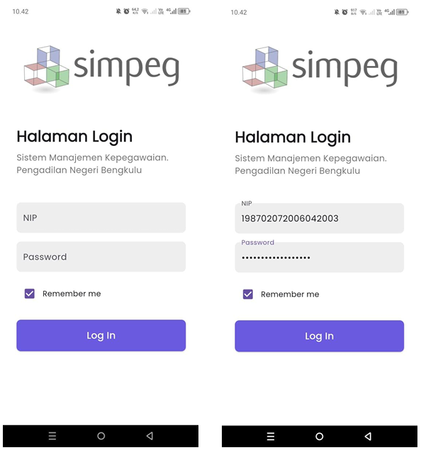
  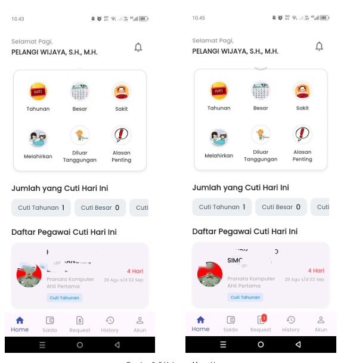
  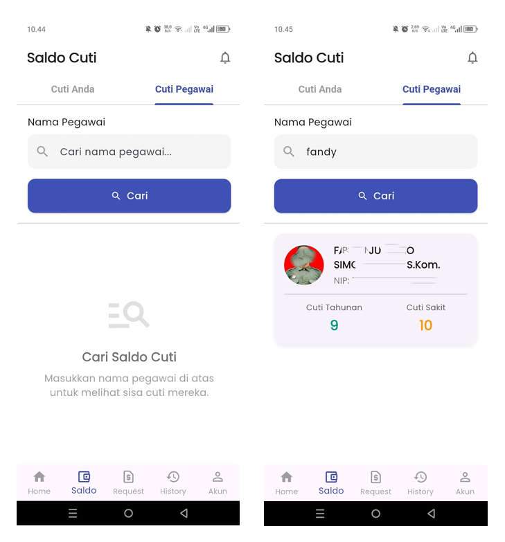
  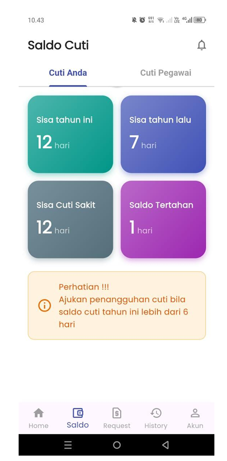
  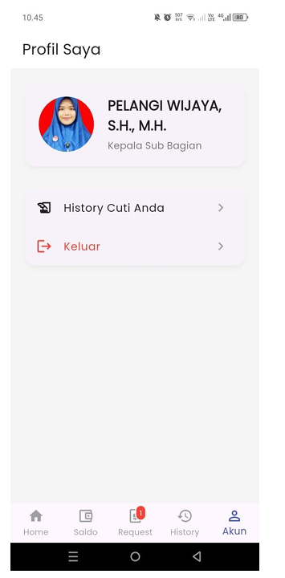
</p>

### 2. Pengajuan Cuti

Pegawai mengisi form pengajuan cuti dalam beberapa tahap, mulai dari memilih jenis cuti dan tanggal, melengkapi data pendukung, sampai mengirim pengajuan.

<p>
  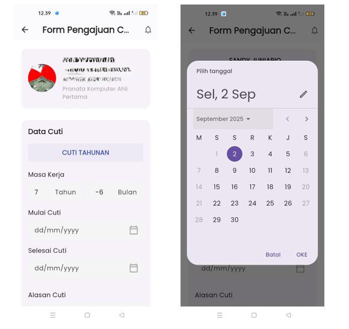
  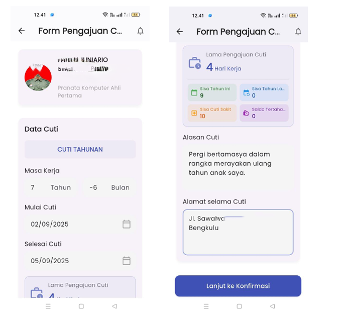
  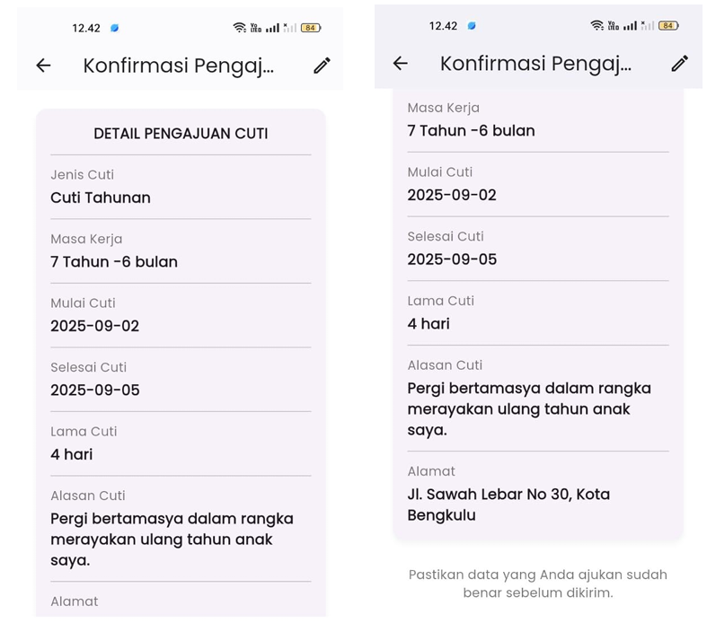
  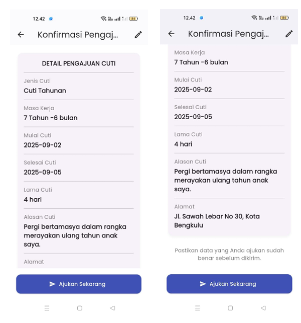
  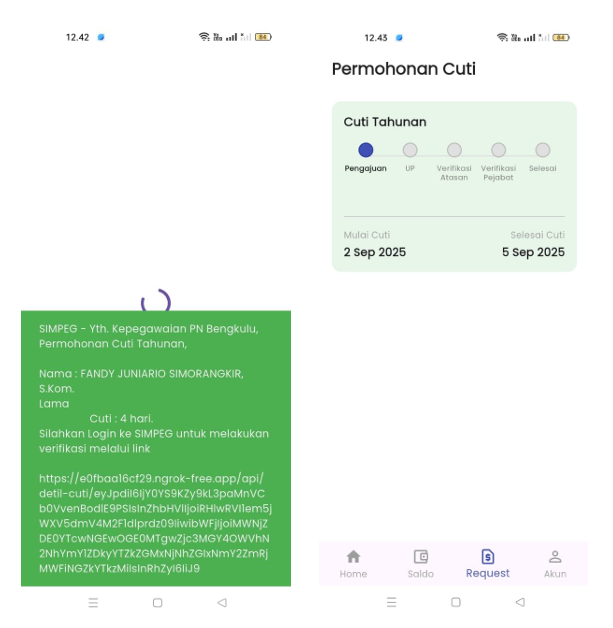
</p>

### 3. Persetujuan Berjenjang

Pengajuan diproses bertahap oleh beberapa peran, yaitu up, atasan langsung dan pejabat berwenang. Setiap peran memiliki tampilan untuk menyetujui atau menolak pengajuan.

<p>
  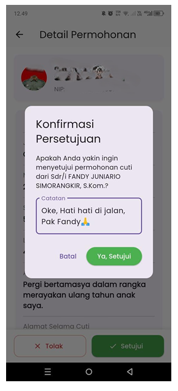
  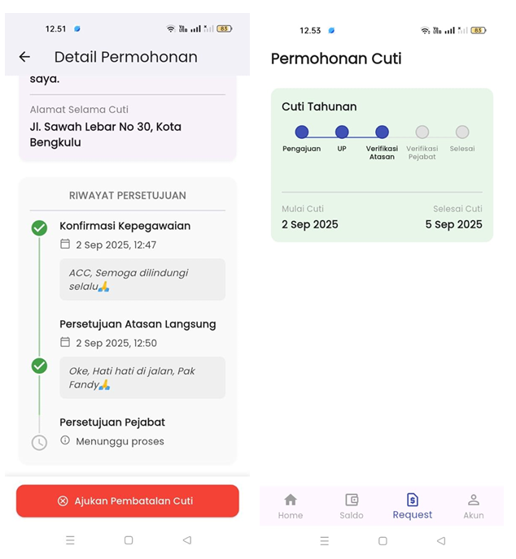
  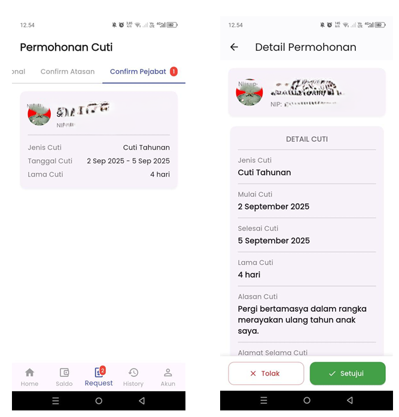
  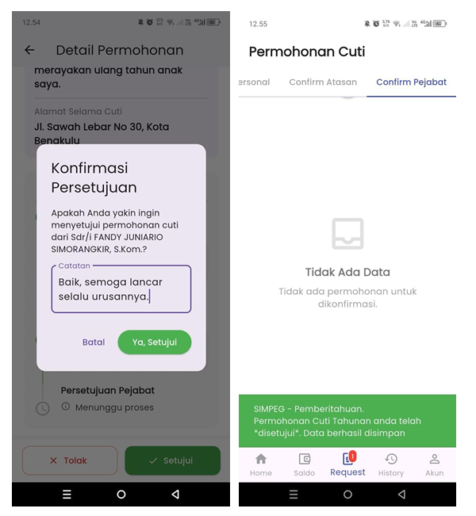
  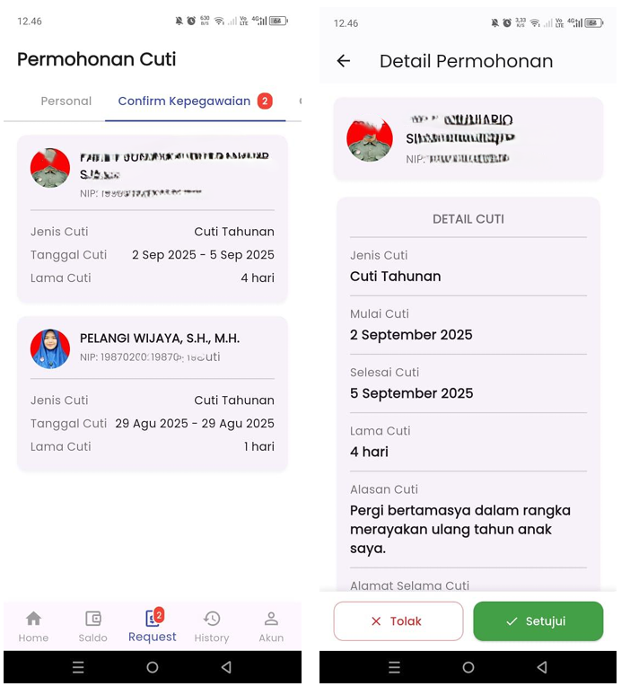
  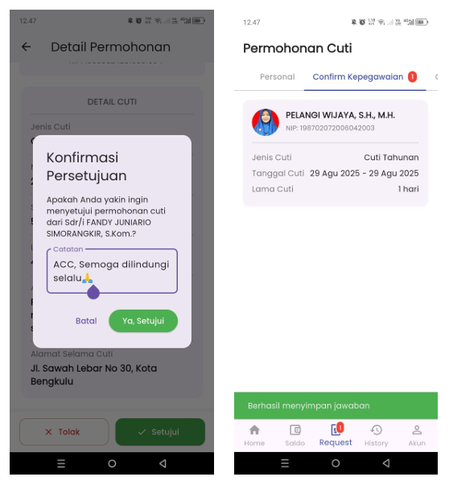
  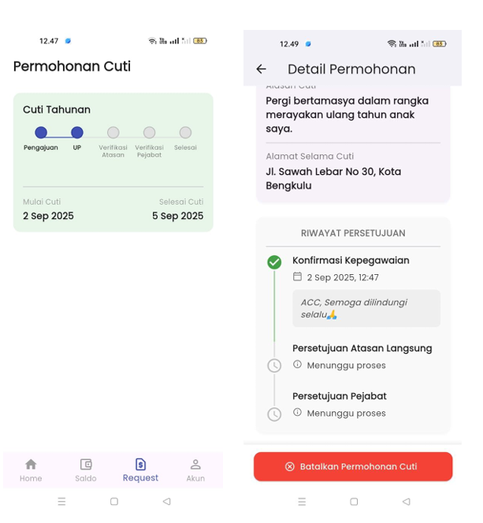
</p>

### 4. Pembatalan Cuti

Pegawai dapat mengajukan pembatalan cuti yang sudah diajukan atau disetujui. Pembatalan juga melalui alur persetujuan dan ditutup dengan halaman konfirmasi.

<p>
  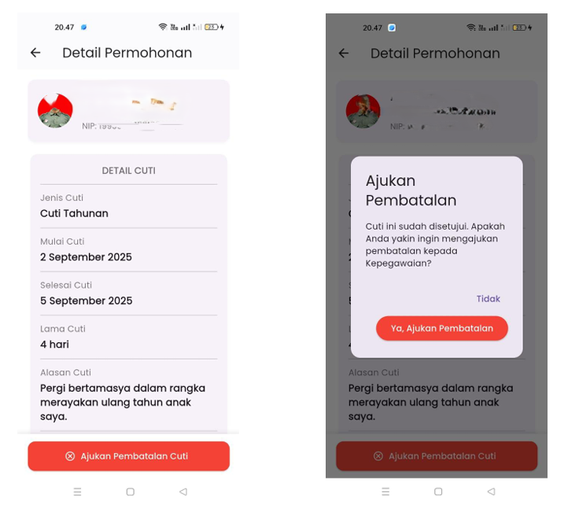
  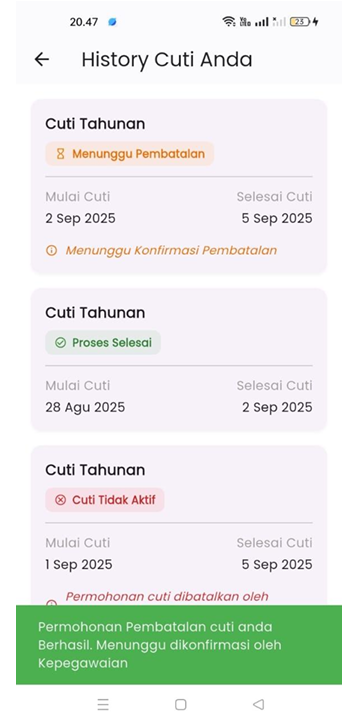
  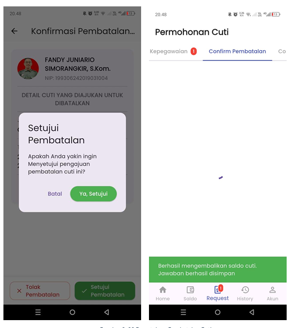
  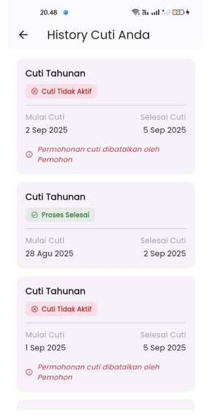
  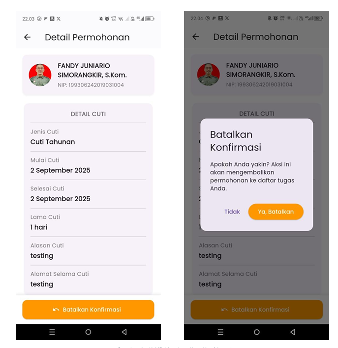
</p>

### 5. Riwayat

Seluruh pengajuan cuti dan proses persetujuannya tercatat di halaman riwayat, sehingga status setiap pengajuan dapat dipantau.

<p>
  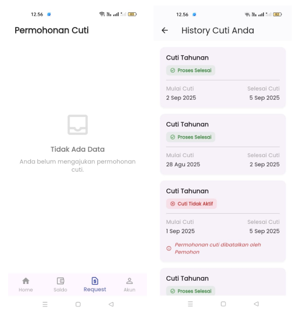
  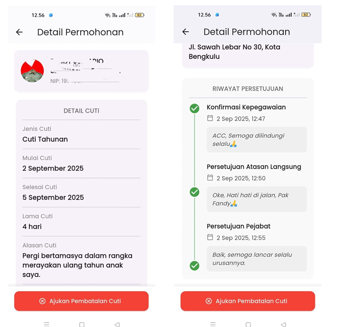
</p>

## Teknologi

| Kategori | Teknologi |
|---|---|
| Framework | Flutter |
| Bahasa | Dart |
| State management | Provider |
| Penyimpanan aman | flutter_secure_storage |
| Backend | REST API (Laravel), dikerjakan oleh tim backend |

## Struktur Proyek

```
lib/
├── core/        # Konstanta API dan warna aplikasi
├── providers/   # State management (Provider)
├── screens/     # Halaman-halaman aplikasi
├── services/    # Komunikasi dengan API
└── widgets/     # Komponen UI yang dipakai ulang
```

## Cara Menjalankan

Prasyarat: [Flutter SDK](https://docs.flutter.dev/get-started/install) sudah terpasang.

```bash
git clone https://github.com/ronbob22/simpeg-mobile.git
cd simpeg-mobile
flutter pub get
flutter run
```

> **Catatan:** Aplikasi ini terhubung ke backend milik instansi yang tidak dibuka untuk umum, sehingga fitur yang membutuhkan data dari server tidak dapat dijalankan secara penuh oleh pihak luar. Silakan lihat bagian **Tampilan Aplikasi** untuk gambaran fungsinya.

## Peran Saya

Saya mengerjakan sisi **frontend mobile**: desain antarmuka, integrasi REST API, manajemen state dengan Provider, dan alur persetujuan multi-role. Backend dikerjakan oleh tim lain (senior saya).

## Kontak

Ronald Yakop Simorangkir
- GitHub: [@ronbob22](https://github.com/ronbob22)
- Email: simorangkir.jakop@gmail.com